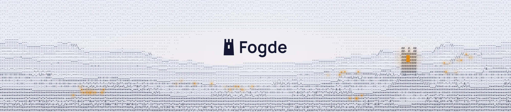

<picture>
  <source media="(prefers-color-scheme: dark)" srcset=".github/assets/banner-dark.png">
  
</picture>

Named after the *fogde*, the bailiff who ran a district on the crown's behalf in medieval Sweden, Fogde runs your coding agents, repos, and notes on your behalf.

Fogde is a minimal desktop workspace for developers who build with coding agents. Talk to agents from one place, see the moment an agent needs you, follow your GitHub repos, and keep your notes close, on your own machine or on your own server.

## Status

Early development and moving fast. Every push to `main` ships a release, so things change daily and sometimes break.

## Development

You need [rustup](https://rustup.rs), [just](https://just.systems), [cargo-binstall](https://github.com/cargo-bins/cargo-binstall) and [Zig](https://ziglang.org/download/). The pinned Rust toolchain installs itself on first use. The desktop app is built on [GPUI](https://github.com/zed-industries/zed/tree/main/crates/gpui) through [GPUI Kit](https://github.com/longbridge/gpui-kit), which also needs:

- **macOS:** macOS 15 or later and the Xcode Command Line Tools (`xcode-select --install`).
- **Windows:** Visual Studio 2022 Build Tools with the *Desktop development with C++* workload, and CMake on `PATH`.
- **Linux:** a Wayland or X11 session with a working Vulkan driver, and on Ubuntu 24.04:

  ```sh
  sudo apt install gcc g++ clang libfontconfig-dev libwayland-dev libxkbcommon-x11-dev libx11-xcb-dev libssl-dev libzstd-dev libvulkan1 libasound2-dev
  ```

```sh
# Once: check tools, and cargo-packager at the commit with the AppImage fix CI uses
cargo binstall cargo-deny cargo-shear cargo-nextest typos-cli zizmor cargo-zigbuild sqlx-cli
cargo install cargo-packager --git https://github.com/crabnebula-dev/cargo-packager --rev d3a520ef0e3ddc4325cefa982ed5fd7322484354 --locked

# Run the app against a separate ~/Fogde-dev home
just dev

# Package the app for this OS into target/packages
just build

# Regenerate the app icons from app-icon.svg and app-icon-macos.svg
just icons

# Before every commit: formatting, Clippy, tests, the file length limit,
# the checked SQL, cargo-deny, cargo-shear, typos and zizmor
just check
```

## License

Licensed under either of [Apache License, Version 2.0](LICENSE-APACHE) or [MIT license](LICENSE-MIT), at your option.

Unless you explicitly state otherwise, any contribution intentionally submitted for inclusion in Fogde by you, as defined in the Apache-2.0 license, shall be dual licensed as above, without any additional terms or conditions.
